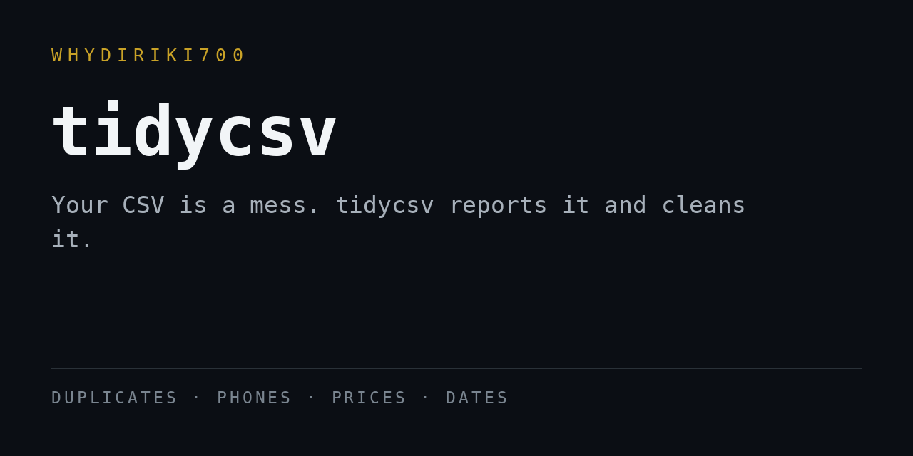

# tidycsv

Real world CSV files are messy. tidycsv reports the mess and cleans it.

Marketplace exports and hand kept spreadsheets mix duplicate rows, stray
whitespace, phone numbers in three different formats, prices written as
"Rp 1.500.000", and dates in five formats inside one column. tidycsv reads
the header, works out which columns are phones, money, and dates, and gives
you a report plus a cleaned file.

## What it fixes

- Duplicate rows, including rows that only become duplicates after cleaning
  (the same phone number written two ways)
- Stray whitespace in every cell
- Phone columns: Indonesian numbers normalized to +62 form
  (0812-3456-7890, 62812..., and +62 812... all become +62812...)
- Money columns: "Rp 1.500.000" becomes 1500000, decimal commas become points
- Date columns: 12/11/2026, 12-11-2026, 5 Jan 2027 and friends become ISO
  yyyy-mm-dd
- Ragged rows with too few or too many cells are padded or trimmed and counted

Column kinds are guessed from header names (phone, hp, wa, harga, price,
total, tanggal, date, and similar words, in English and Indonesian).

## Usage

Report only:

```
python -m tidycsv export.csv
python -m tidycsv export.csv --json
```

Clean:

```
python -m tidycsv export.csv --clean -o export-clean.csv
```

## Example report

```
rows: 3  columns: 4  rows after clean: 2
  duplicate_rows: 1
  ragged_rows: 0
  whitespace_cells: 2
  phones_normalized: 2
  money_normalized: 1
  dates_normalized: 1
```

## Tests

```
python -m unittest discover -s tests
```

Zero dependencies. Python 3.9+. MIT license.
